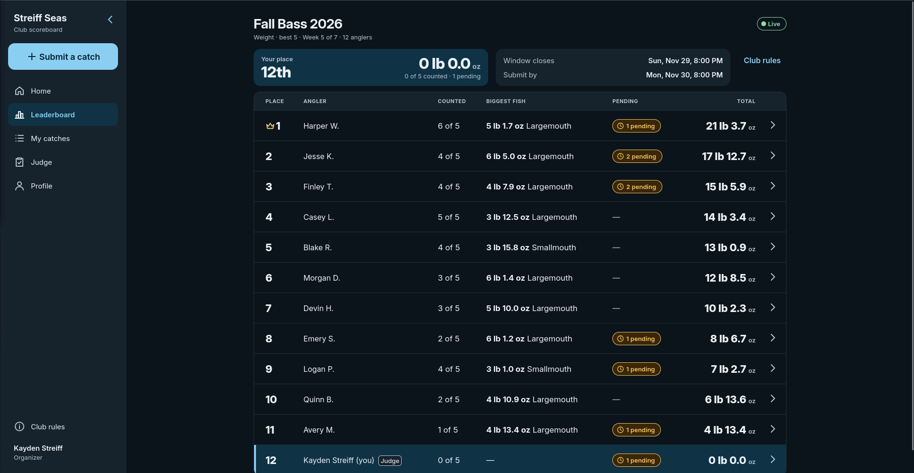
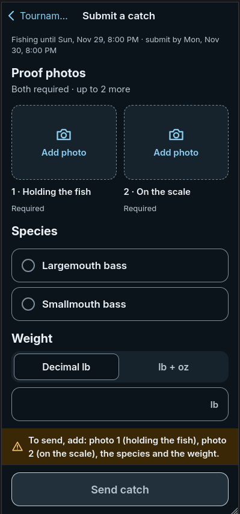
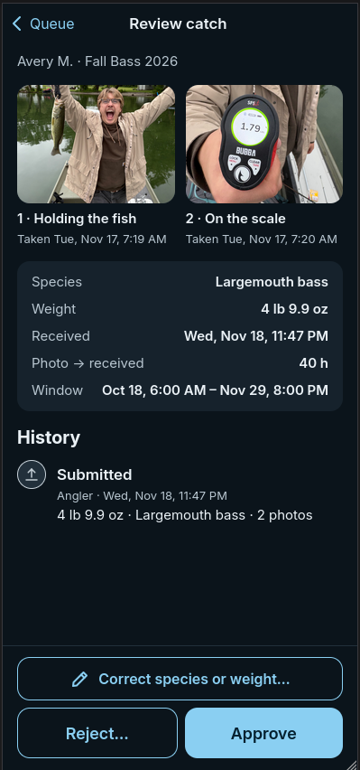
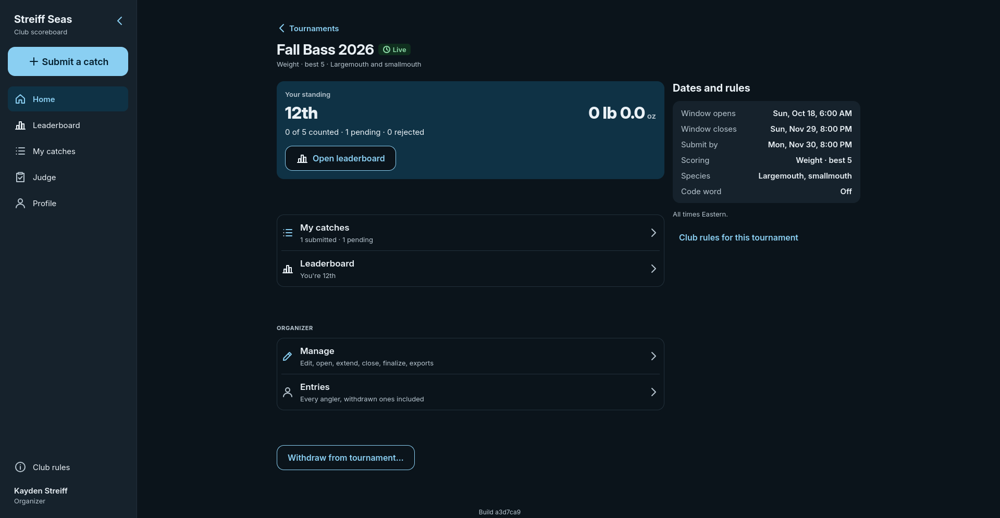
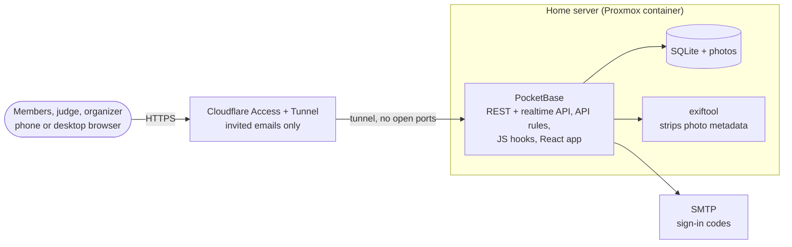

# Streiff Seas

A members-only live leaderboard for a fishing club's six-week tournaments. Anglers submit each catch from their phone with two proof photos, the judge approves or rejects it, and the standings update live for everyone.

Built for a club of about 15 anglers, self-hosted on a home server. The first real tournament is planned for summer 2027.

**Status: v0.9.0, pre-season.** All four MVP slices (submit, score, judge, finalize) are built and tested, and the app runs in production at [streiffseas.com](https://streiffseas.com) with demo data. CI, the staging server, offsite backups and uptime alerts are still to do (see [Status](#status)).

<p align="center">
  
</p>
<p align="center">
  
  &nbsp;&nbsp;
  
</p>

## What it does

| Role | Can |
|---|---|
| **Member** | Join a live tournament, submit catches (weight or length, species, two required photos plus up to two more), edit, add photos to or retract a catch while it's pending, withdraw and rejoin, follow the live leaderboard, see the history of every catch |
| **Judge** | Work a queue of pending catches with automatic flags (no capture time, outside the window, photo taken more than 24 hours before sending, photo added later), then approve, reject with a reason, or correct the reading. Judges never approve their own catches: the backup judge does |
| **Organizer** | Create, open, extend, close and finalize tournaments, manage entries and species, export the results and audit log as CSV with a SHA-256 to post in the club chat |

Scoring follows the club's written rules in [`docs/scoring.md`](docs/scoring.md): each angler's 10 best verified fish, with automatic culls, tie-breaks by fish position and shared places. It all lives in one pure module ([`web/src/lib/scoring.ts`](web/src/lib/scoring.ts)) that uses whole numbers only (hundredths of an ounce, quarter-inches), and every worked example in the rules is a test.

The app works on phones, tablets and desktops, in light and dark mode, and each member picks their own units.

<p align="center">
  
</p>

## How it's built



- **Backend:** [PocketBase](https://pocketbase.io) v0.40.4 (pinned with its sha256 in `POCKETBASE_VERSION`). The schema and every API rule are migrations in `pb_migrations/`. Server-side checks are JavaScript hooks in `pb_hooks/`.
- **Frontend:** React 19, Vite and TypeScript in `web/`, built into `pb_public/` and served by PocketBase on the same origin. The only runtime dependencies are `react`, `react-dom` and `pocketbase`.
- **Hosting:** an unprivileged Debian container on Proxmox, reached only through a Cloudflare Tunnel. Deploys are scripted with a backup, a smoke test and automatic rollback (`scripts/deploy.sh`, [`docs/ops.md`](docs/ops.md)).

### Security

- **Two locks on the door:** Cloudflare Access lets only invited emails reach the site at all, and PocketBase then signs each member in with an 8-digit emailed code. There are no passwords for members.
- **Locked by default:** every collection starts with no access. Each rule that opens something has its own row in [`docs/security.md`](docs/security.md) and its own test. Fields only the server may set (status, judge, flags, reason, revision) are refused by the rule itself, before any hook runs.
- **Nothing is deleted:** nobody can delete anything through the API, not even the superuser. A rejected or retracted catch keeps its reason, a withdrawn entry stays on record, and photos can only be added.
- **No location data is kept:** every photo is stripped with exiftool on the server and refused if anything location-capable is left.
- **Audit log:** every change to a catch, entry or tournament writes exactly one audit row, and members can read the history of every catch they can see.
- **Conflicts are caught:** every judge action carries the catch's revision, so if the angler edited the catch after the judge opened it, the action is refused and the catch reloads.

## Try it

**Live site:** [streiffseas.com](https://streiffseas.com) sits behind Cloudflare Access, so ask Kayden to add your email. Then enter it, type the PIN Cloudflare emails you, and sign in with the app's emailed code. It's loaded with demo data: one live tournament with a judge queue, and two finished ones.

**Locally** (Linux x86-64: the pinned PocketBase build is linux_amd64):

1. Install Node 24 (`nvm use` reads `.nvmrc`) and exiftool (`apt install libimage-exiftool-perl` or `dnf install perl-Image-ExifTool`).
2. `npm ci --ignore-scripts`
3. `scripts/fetch-pb.sh` downloads PocketBase and checks its sha256.
4. `./pocketbase serve --dev` (on 127.0.0.1:8090), then `npm run dev` in another terminal (Vite proxies `/api` to PocketBase).
5. Sign-in is by emailed code, so create a superuser at `http://127.0.0.1:8090/_/` and set Settings → Mail to any SMTP server or a local mail catcher.

## Tests

```sh
npm test                          # all tests (Vitest)
npm test -- test/rules.test.ts    # one file
npm run check                     # typecheck, tests and production build
```

There are 1,326 tests in 72 files. Most of them boot a throwaway PocketBase from `pb_migrations/` and `pb_hooks/` and check the real API: who may read, create and change what, the hooks' checks, photo stripping against fixtures with planted GPS, the audit log, realtime updates, and the deploy and archive scripts against stand-ins for `curl`, `systemctl` and `sqlite3`.

## Repository layout

```
web/             React app: screens/, components/, lib/ (scoring.ts and the other pure logic)
pb_migrations/   schema and API rules, append-only
pb_hooks/        server-side checks (PocketBase's goja runtime: CommonJS, no Node APIs)
test/            Vitest suites, the PocketBase test harness, photo fixtures
scripts/         fetch-pb, make-bundle, deploy, seed-demo, wipe-demo, archive-event
docs/            spec, rules, security, decisions, screens, architecture, ops
```

## Docs

| Doc | What's in it |
|---|---|
| [`docs/SPEC.md`](docs/SPEC.md) | Scope, roles and the invariants every change must keep |
| [`docs/scoring.md`](docs/scoring.md) | The club's scoring rules, with worked examples |
| [`docs/security.md`](docs/security.md) | Who may do what, row by row, with test IDs |
| [`docs/decisions.md`](docs/decisions.md) | Every decision and why. It wins over every other doc |
| [`docs/architecture.md`](docs/architecture.md) | Diagrams: context, data model, rule posture, submission and finalize flows, deployment |
| [`docs/screens.md`](docs/screens.md) | Every screen, its states and its copy |
| [`docs/ops.md`](docs/ops.md) | Runbook: install, deploy, backups, the tournament checklists |
| [`docs/dev-lifecycle-guide.md`](docs/dev-lifecycle-guide.md) | How the project is planned, built and released |

## Status

| Done | To do before the first tournament |
|---|---|
| Submit, score, judge and finalize slices; profiles and stats | CI and release bundles on GitHub Actions (M0-05a) |
| Photo stripping, audit log, realtime leaderboard | Staging server with automatic deploys (M0-06) |
| Production container, tunnel, Access, SMTP, scripted deploy | 15-minute live-update soak test through the tunnel (M0-07) |
| Demo data for grading, with a scripted wipe | Encrypted offsite backups and uptime alerts (M0-08), then the M0 gate (M0-09) |

## License

Copyright © 2026 Kayden. All rights reserved. The code is public to read, but it isn't licensed for reuse.
