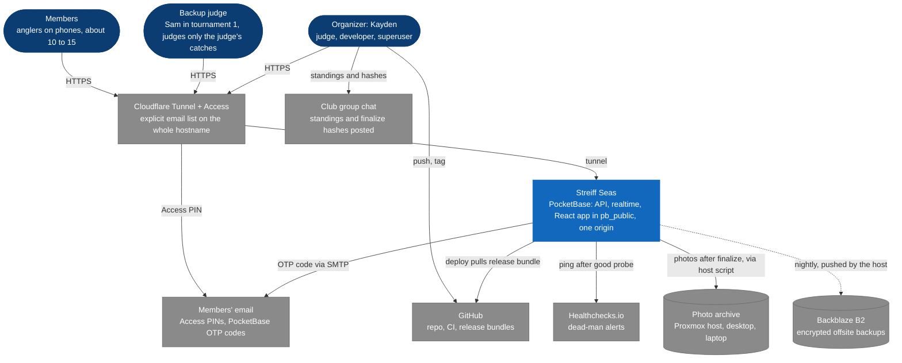
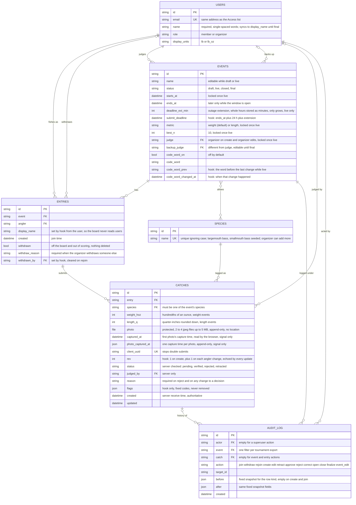
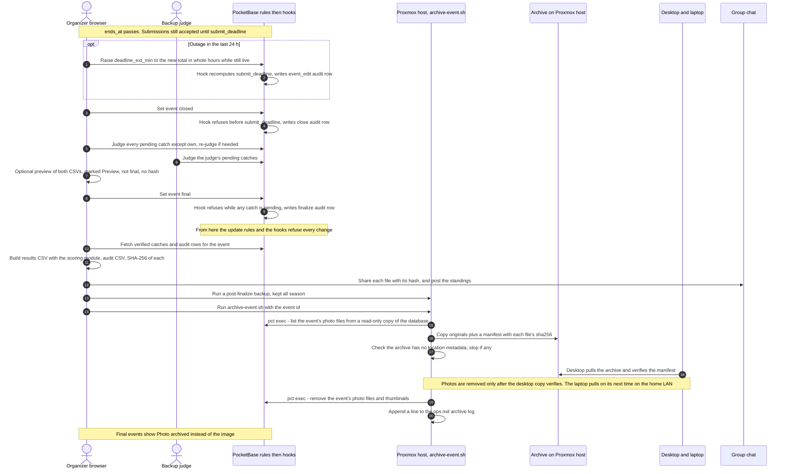
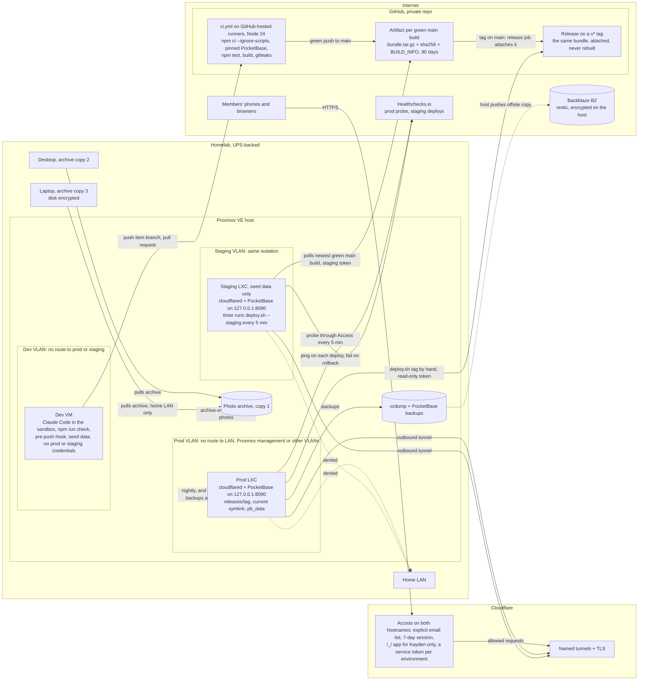

# Architecture: Streiff Seas

**Status:** Draft v0.7, 16 Nov 2026. §3 brought in line with the migrations (users create and read, nothing deleted), §4 with the `rev` compare-and-swap, "What the Phase 2 work must confirm" with the spike result; CI, the pre-push hook and the staging pipeline are marked not built. v0.6 (7 Oct 2026): Section 5 redrawn for the 2026-10-07 pipeline (`decisions.md` L3): a bundle built on every push to `main`, a staging container that deploys it automatically, and a tag that promotes the same bundle to prod; restic for the offsite backups. v0.5 (6 Oct) was brought in line with `security.md` v0.9, `scoring.md` v0.6.1 and `decisions.md` through 2026-10-06 (Node 24, public catch history, two required photos, `photo_captured_at`, fixed flag codes and audit snapshots, `rev` echoed by anglers too, judge must be an organizer with automatic entries, judge step-down, live and closed event edits, Open preconditions, code word history on the event). v0.4 (1 Oct) matched `security.md` v0.3. Regenerate at milestones (M0, M1, off-season), not on every change.
**Sources of truth:** `SPEC.md` (scope, roles, invariants), `scoring.md` (rules), `security.md` (API rules and test IDs), `decisions.md` (choices). This page only draws them; where it disagrees with any of them, they win and this page gets fixed. `pb_migrations/` is the source of truth for the schema once it exists.

## What changed from the guide's diagrams

- **Frontend is React + Vite + TypeScript**, still served from PocketBase's `pb_public/` on the same origin as the API. Source lives in `web/`; CI runs `vite build`, and prod only ever receives built files. Node 24 LTS in development and CI (`decisions.md` 2026-10-06).
- **Prod deploys a CI-built bundle**, not a git checkout: built `pb_public/`, `pb_hooks/`, `pb_migrations/` and `POCKETBASE_VERSION` in one tarball with a sha256. CI builds it on every push to `main`; a **staging container** deploys each one automatically; a tag attaches that same bundle to a release, and Kayden deploys it to prod by hand. What prod runs is byte-for-byte what CI tested and staging ran. Prod needs no Node, no npm and no git (`decisions.md` L3).
- **Roles follow `SPEC.md`:** `users.role` is `member | organizer`; judging rights come from `events.judge` and `events.backup_judge` per tournament. The judge must hold the organizer role when the tournament is created and on any organizer edit; the judge and backup judge are entered in the tournament automatically. The organizer (Kayden) is also judge and PocketBase superuser; Sam is backup judge for tournament 1 and approves only the judge's catches.
- **The judge can step down** mid-tournament as a logged superuser step: the backup judge becomes the judge (the organizer role isn't required then) and a new backup judge is named. The organizer still closes and finalizes (`scoring.md` §7, example 28).
- **Format follows `scoring.md`:** six-week window, best 10 verified fish, weight (hundredths of an ounce, `weight_hoz`) or length (quarter-inches, `length_q`). No `grace_min`, `dead` or `min_length_q`; `submit_deadline` (= `ends_at` + 24 h + `deadline_ext_min`) replaces the grace window.
- **Rules are locked by default:** every rule starts `null` (superuser only) and is opened one cell at a time in `security.md`, each with a test.
- **Every catch has two required photos** (holding the fish; on the scale or board) and up to two more, 4 in total, append-only. Each photo's capture time is kept in `photo_captured_at`; any photo after the first with no time, or more than 24 h from the first, is flagged, never refused.
- **Photos are visible to every signed-in member**, served as protected files so a bare file URL is useless without a signed-in session (section 3). Rejected and retracted catches, and their photos, are visible only to the angler and the judges.
- **Catch history is public to members:** every signed-in member reads the audit rows of any catch they can see, including an overturned rejection and its reason. Event and entry rows stay organizer-only.
- **Members join a tournament themselves** with a Join button, as in v1. Joining creates their entry; catches hang off the entry.
- **Anyone can be taken out of a tournament** without deleting anything: a member can withdraw themselves, and the organizer can withdraw anyone from the organizer screen with a reason. `withdrawn_by` records who did it, so an angler can't undo the organizer's removal. A withdrawn entry drops off the board and stops scoring, but it and its catches stay in the database and the audit log.
- **Only the tournament's species can be submitted.** The create and update rules refuse any other species, so the judge never rejects for species.
- **Anglers can fix their own pending catch:** edit species and measurement, add photos, or retract it. Every angler and judge request echoes the `rev` it loaded, and the hook re-checks it inside the save, so a stale or doubled request is refused.
- **The judge can re-judge** (change a decision, with a reason) while the event is live or closed; a correction always leaves the catch verified; nothing changes once final.
- **Event edits narrow as the tournament moves on:** anything while draft; once live, only `name`, the code word, `backup_judge` and a later `ends_at` while the window is open; once closed, only `backup_judge`. Open is refused until the draft is complete. A code word change on a live event stores the previous word and when it changed, so every judge sees both.
- **Finalize ends in an archive:** results and audit CSVs with a SHA-256 posted to the group chat, then a host-side script exports the photos and removes them from the app.
- **The photo archive lives in three places:** the Proxmox host, the desktop and the laptop.
- **Offsite backup is Backblaze B2**, pushed by the Proxmox host and encrypted there by restic before upload (confirmed 2026-10-01; restic chosen 2026-10-07).
- **Recovery targets come from `SPEC.md`:** restore within 12 h (24 h from offsite), lose at most 24 h of data. The guide's 60-minute target was for one-day events. An outage stretches the 24-hour rule and, in the last 24 hours, the final deadline (`scoring.md` §6).

---

## 1. System context

Everyone reaches the app through Cloudflare Access. You reach production only through GitHub releases and the Proxmox host. Dashed means pushed by the host, not the container.



Why the hashes go to the group chat: the organizer is also judge and superuser, so a hash only the organizer holds proves nothing to anyone else. Posting it where every member can see it makes later tampering detectable by the club, not just by you.

---

## 2. Data model

Fields are the ones `security.md` v0.9 lists. `entries.display_name` is copied from the user so the leaderboard never reads `users`. Superusers are PocketBase's separate `_superusers` collection, not a `users` row: you have one of each.



**Flag codes** (`security.md` "Flag codes"): `no_capture_time`, `before_window`, `after_window`, `late_submit` at create; `photo_added` when the angler adds a photo later; `extra_photo_no_time` and `extra_photo_far` for any photo after the first, at create or when added. One list is shared by the hook and the web app.

**Audit snapshots** (`security.md` `audit_log`): catch rows hold `species`, `weight_hoz`, `length_q`, `status`, `reason`, `photo`, `photo_captured_at`, `flags`, `rev`; entry rows hold `withdrawn`, `withdraw_reason`, `withdrawn_by`; event rows hold every `events` field.

---

## 3. Rule posture: locked by default

Every collection starts with all five rules `null` (superuser only). A cell opens only when `security.md` gives it an expected result and a test ID; the rule text there is the draft, and the tests are the source of truth. Hooks write through `$app.save()`, which bypasses rules, so audit rows, automatic entries and server-only fields never need an open rule. Realtime subscriptions follow the list and view rules. Every list and view rule starts with `@request.auth.id != ""` (invariant 8), and every test also runs with Access absent.

| Collection | List / view | Create | Update | Delete |
|---|---|---|---|---|
| `users` | Own record; organizer sees all (R-USR-L, V) | Anyone not signed in, as `role = member` only; no `verified`, `emailVisibility` or organizer role; name always set (R-USR-C-01, C-04 to C-09; `decisions.md` 2026-10-25) | Own record; never `role`, `email`, `verified` or `emailVisibility` (R-USR-U) | `null` |
| `events` | Signed-in members; drafts organizer only (R-EVT-L, V) | Organizer, as `draft` only, judge an organizer and different from the backup judge, no hook-set fields; hook enters the judge and backup judge (R-EVT-C) | Organizer, never once `final`; `metric`, `best_n`, `species`, `starts_at` and `judge` locked once live; only `backup_judge` once closed; hook enforces draft → live → closed → final, the Open checklist, later-only `ends_at`, the growing extension and the code word history. Judge step-down is a superuser request the hook allows (R-EVT-U) | `null` |
| `species` | Signed-in members (R-SPC-L) | Organizer (R-SPC-C) | `null` | `null` |
| `entries` | Signed-in members; a withdrawn entry only to its angler, the judge, the organizer, and the backup judge for the judge's own entry (R-ENT-L) | Self-join while live, before `submit_deadline` (R-ENT-C) | Withdraw or rejoin: the angler on their own entry, the organizer on anyone's; never once `final` (R-ENT-U) | `null` |
| `catches` | Signed-in members; rejected and retracted only to the angler and the judges; `photo` is a protected file (R-CAT-L, V, F) | Own non-withdrawn entry, live event, in window, allowed species, at least 2 photos, no server-only fields (R-CAT-C) | Angler: edit, add photos or retract own pending catch, echoing `rev`. Judge: approve, reject, correct or re-judge someone else's, echoing `rev`, setting a status or changing the species or measurement (R-CAT-U) | `null` |
| `audit_log` | Organizer: all rows. Everyone else: every row of each catch they can see, plus their own rejected and retracted catches; the judge (including one who stepped up without the organizer role) every row of the catches they judge; the backup judge every row of the judge's catches. Event and entry rows: organizer only (R-AUD-L) | `null`: hooks only | `null` | `null` |

Cells with no dedicated row are covered by the `R-ALL-*` sweeps in `security.md`. Every Delete cell is `null`, and `pb_hooks/no_deletes.pb.js` also refuses every delete from the superuser and the admin UI (R-ALL-D-02; `decisions.md` 2026-11-16).

**Why photos are protected even though everyone can see them.** PocketBase serves an unprotected file to anyone who has its URL, with no sign-in. Access normally stands in front, but invariant 8 says the app must hold up with Access absent. As a protected file, a photo needs a short-lived file token, which only a signed-in user who passes the `catches` view rule can get (`pb.files.getToken()` in the React app). The result is the same for members (everyone sees every angler's visible photos), and a leaked link stops working within minutes.

**Why photos are append-only.** PocketBase deletes a file that is removed from or replaced in a file field, which would destroy evidence. The angler update hook refuses any request whose new `photo` list drops or reorders an existing file, or changes an existing `photo_captured_at` entry, checked before save so a refused request deletes nothing. Confirmed on v0.40.4 by the photo spike (`decisions.md` 2026-11-13).

**Why catch history is public.** The `reason` on a catch says why it was rejected, but not what a correction changed; the audit row's `before` and `after` do. The club chose to let every member read the history of any catch they can see, so the judge's decisions are open to everyone (`decisions.md` 2026-10-01 "Catch history is public to members"). The `audit_log` list rule mirrors the `catches` list rule, so a catch that is now rejected or retracted, or sits on a withdrawn entry, keeps its rows hidden from other members. Event and entry rows (open, close, finalize, event_edit, join, withdraw) have no `catch`, so they stay organizer-only; the hashed audit CSV at finalize makes the full log checkable by the club.

**Why `rev`.** Anglers can edit a pending catch, so a judge could otherwise approve a value that changed after they loaded it. Every judge request echoes the `rev` it saw; if the angler edited in between, the update rule refuses it and the queue reloads (R-CAT-U-13). Anglers echo `rev` too, so a retried photo upload whose first attempt already landed is refused instead of adding the photo twice (R-CAT-U-39). The rule reads `rev` before the save, so the hook compare-and-swaps it in `onRecordUpdateExecute` and refuses if it moved (R-CAT-U-40).

**Why the code word history lives on the event.** The backup judge, and a judge who stepped up without the organizer role, can't read event audit rows, but must see the same two words as the judge. The hook keeps `code_word_prev` and `code_word_changed_at` on the event, which every member who can read the event can read (`decisions.md` 2026-10-05).

---

## 4. Catch submission, editing, judging and live update

Rules run before hooks. The heartbeat and refetch-on-reconnect close the stale-board gap. A retry reuses the same `client_uuid`, so the unique index turns a double submit into a no-op; the app then confirms by looking the catch up by `client_uuid`. Every other change reloads the record before a retry and sends nothing if the change already landed.

```mermaid
sequenceDiagram
  autonumber
  actor A as Angler phone, React app
  participant CF as Cloudflare Access + Tunnel
  participant PB as PocketBase rules then hooks
  participant DB as SQLite + pb_data/storage
  actor J as Judge or backup judge
  participant M as Open leaderboards

  A->>A: Read each photo's DateTimeOriginal, then resize and re-encode to JPEG, attach client_uuid
  alt Signal and request accepted
    A->>CF: POST /api/collections/catches/records with 2 to 4 photos
    CF->>CF: Access session valid for this email?
    CF->>PB: Forward over tunnel
    PB->>PB: createRule - own entry not withdrawn, event live, starts_at to submit_deadline, event species only, at least 2 photos, no server-only fields
    PB->>PB: Hook - type and size, location strip or refuse, status pending, rev 1, flags from capture times vs window and receive time
    PB->>DB: Save catch and photos, write create audit row with the fixed snapshot
    PB-->>A: 200 - UI shows Received
    PB--)M: SSE catches create, counted as pending
  else No signal, timeout or error
    A->>A: UI shows NOT SENT with Retry, form locked, resend keeps the same client_uuid
    A->>CF: Retry after a lost response
    CF->>PB: Forward
    PB-->>A: Unique index rejects the duplicate
    A->>CF: GET catch by client_uuid
    CF->>PB: Forward
    PB-->>A: Found - UI shows Received
  end
  opt Angler fixes the catch while it is pending
    A->>PB: PATCH own catch with the rev it loaded - edit species or measurement, add a photo, or set retracted
    PB->>PB: updateRule angler branch - own pending catch, entry not withdrawn, event live, before submit_deadline, rev matches
    PB->>PB: Hook - existing photos and capture times kept, exiftool strip of the added photo, flag it; rev compare-and-swap in onRecordUpdateExecute (rev plus 1)
    PB->>DB: Update catch, write edit or retract audit row
    PB--)M: SSE catches update to those who can still see it. Other boards drop a retracted catch at their next heartbeat refetch
  end
  J->>CF: PATCH catch with the rev it loaded - approve, reject with reason, correct, or re-judge
  CF->>PB: Forward
  PB->>PB: updateRule judge branch - not own entry, judge or backup judge on the judge's catch, event live or closed, rev matches, not retracted, sets a status or a correction
  alt rev is stale because the angler edited
    PB-->>J: Refused - queue reloads the catch
  else rev matches
    PB->>PB: Hook - set judged_by, reason on reject and on any change to a decision, a correction sets verified
    PB->>DB: Update catch, write one approve, reject or correct audit row with before and after
    PB--)M: SSE catches update
  end
  M->>M: Scoring module recomputes standings from verified catches on non-withdrawn entries
  loop Every 60 s
    PB--)M: Heartbeat keeps the stream under the 125 s edge timeout
  end
  Note over M: On PB_CONNECT or tab visible again, refetch all. Silent 150 s, poll every 30 s
```

## 4b. Close, finalize and archive

Results are computed by the same scoring module the leaderboard uses, in the organizer's browser, so there is no second scoring path to test. The archive runs on the Proxmox host and reaches into the container; the container never reaches out to the host or LAN.



Notes on the archive step:
- Photos are removed **outside the API**, so invariant 6 (nothing deleted through the API) holds. The `photo` field keeps its filenames; the app shows "Photo archived" for `final` events and never requests the files.
- Every photo of every catch is archived, including those on rejected and retracted catches, since they are part of the record the audit hash covers.
- The desktop and laptop **pull**, so the server holds no credentials for either. Each uses its own key, restricted to read-only access to the archive folder.
- Three copies on three machines, all in the same house; the encrypted B2 backups are the only copy outside it.
- The laptop leaves the house, so it needs full-disk encryption on. The photos have no location data, but they are still members' photos.
- Nightly and post-finalize backups still contain the photos. That is acceptable because they were stored without location data, but it means photo retention equals backup retention. Set both in `ops.md`.

---

## 5. Deployment, build and network map

**Not built as of 16 Nov 2026:** `ci.yml`, the pre-push hook, the bundle artifact, `deploy.sh` and the staging container (M0-05a/b, M0-06; skipped for the deadline). The diagram is the target; the prod and staging containers also need exiftool.

PocketBase listens only on localhost inside unprivileged containers on isolated VLANs with no inbound ports. Prod and staging both **pull** a CI-built bundle; nothing pushes into either. Dashed means pushed by the host. The pipeline is `decisions.md` L3; the commands are in `ops.md` §5.



**Build and deploy, in order** (`decisions.md` L3; commands in `ops.md` §5):
1. Claude Code commits on an `item/<id>` branch in the dev VM after `npm run check` passes. Kayden pushes (the `pre-push` hook runs `npm run check` again) and opens a pull request, which runs CI on GitHub's runners. Kayden reads every migration and rule diff and merges once it's green.
2. On the push to `main`, CI runs again and uploads the bundle as a workflow artifact. Every one of these jobs is `contents: read`.
3. Within 5 minutes the staging timer finds the new green build, verifies it and the commit's ancestry, backs up, switches the symlink, restarts and smoke-tests through Cloudflare; it rolls back on failure and pings Healthchecks either way. Kayden checks the change on his phone.
4. Kayden tags the commit staging is running. The release job, the only one with `contents: write`, checks the commit is on `main`, takes **that commit's** artifact, verifies it and attaches it to the release. It never rebuilds.
5. On prod, `deploy.sh <tag>` checks `FREEZE`, refuses a tag whose commit isn't on `main`, refuses migrations or a PocketBase change while a tournament is live, downloads the bundle with a fine-grained, read-only, single-repo token, verifies the sha256, backs up by stopping PocketBase and archiving `pb_data`, unpacks into `releases/<tag>`, verifies the PocketBase binary's sha256, switches the `current` symlink, starts and smoke-tests through Cloudflare. Rollback is switching the symlink back.
6. Vite's dev server proxies `/api` to a local PocketBase, so development is same-origin too. Built files never live in git: `pb_public/` is a build output and is gitignored.

---

## Phase 2 results

- **Photo spike:** done 2026-11-13 (`decisions.md` photo-spike row). Option A: exiftool `-all=` through `$os.cmd`, then a scan of the cleaned bytes, fail closed. iPhone Safari run twice; **Android Chrome untested**. The append-only check runs before PocketBase deletes a file.
- **On the pinned binary:** `judge.role` resolves against the submitted body, `@request.body.photo:length` counts uploads, and `rev` is a compare-and-swap in `onRecordUpdateExecute`, not a read inside a transaction (no record update hook runs in one).
- **Soak test (X-ACC-05):** not done (M0-07, skipped for the deadline).

**Settled since v0.4, now in `decisions.md`:** public catch history, two required photos, capture time per photo, flag codes, photo limits, the outage extension in whole hours, `rev` echoed by anglers, correction approves, reasons on changed decisions, fixed audit snapshots, judge must be an organizer with automatic entries, the backup judge sees the judge's withdrawn entry, judge step-down, live and closed event edits, later-only `ends_at`, Open preconditions, code word history on the event, a judge update must change something.
