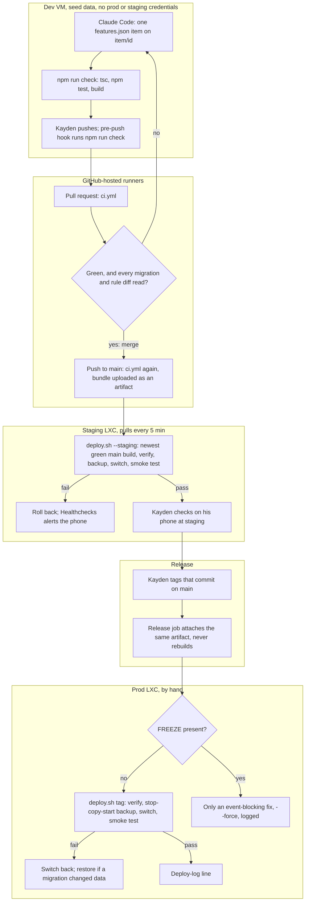

# Development lifecycle guide: Chromie Fishing

**Status:** v2, 7 Oct 2026. Rewritten from v1 (30 Sep 2026) to match `decisions.md` through 2026-10-07. v1 was written before the tournament format, roles and stack were known, and contradicted later decisions in many places (listed below).
**What this is:** the process. How the project goes from agreed rules to a running season, and how to work with Claude Code safely along the way. It does not repeat the facts other docs own, and it points to them instead:

| For | Read | Notes |
|---|---|---|
| Why anything is the way it is | `docs/decisions.md` | **Wins over every other doc, this one included.** Also holds the one list of open items |
| Scope, roles, invariants, top risks | `docs/SPEC.md` | One page |
| Scoring rules and worked examples | `docs/scoring.md` | The examples are the scoring tests |
| Who may do what, with test IDs | `docs/security.md` | The rules matrix; the tests are the truth, not the rule text |
| Screens, states and copy | `docs/screens.md` | 130 state rows, all drawn in Figma |
| Diagrams and data model | `docs/architecture.md` | Redrawn at milestones |
| Running it: network, secrets, deploy, backups, runbook | `docs/ops.md` | Printed for the season |
| What to build next | `features.json` and `progress.md` | The only backlog |
| How Claude Code must behave | `CLAUDE.md`, `.claude/settings.json`, the user-level guard hook | Enforcement lives in the hook and settings, not in prose |

All of these live in the repo, `KaydenCouldBeBetter/ChromeFishingV2`, which is the source of truth (`decisions.md` 2026-10-07). The Claude Project holds a read-only mirror plus the design working files.

---

## What changed since v1

| v1 said | Now | Decided |
|---|---|---|
| One-day events with a "director" | Six-week tournaments; roles are `member` or `organizer`, plus a judge and backup judge per tournament; the organizer judges and the backup judge approves only the judge's catches | `decisions.md` 2026-09-29 to 2026-10-05; `SPEC.md` |
| Plain HTML and ES modules, no build step | React + Vite + TypeScript in `web/`, built into `pb_public/`, same origin as the API | 2026-09-30 |
| `pb_public/scoring.js` | `web/src/lib/scoring.ts`, pure, integers only (`weight_hoz`, `length_q`) | 2026-09-30, `SPEC.md` invariant 1 |
| Late-upload grace window (`grace_min`), minimum lengths, dead-fish penalty | 24-hour submit rule and a final deadline (`submit_deadline` = `ends_at` + 24 h + outage extension); no minimum size; no dead-fish field | `scoring.md` §1, §6 |
| Tie-break by earliest submission | Fish by fish, then a shared place | `scoring.md` §8 |
| One photo | Two required photos (holding the fish; on the scale or board), up to 4, append-only | 2026-10-02, 2026-10-03 |
| Freeze from 7 days before the event | Change control for the whole window; a hard freeze for the last 3 days until results are final | 2026-10-01 |
| Restore within 60 minutes; paper fallback in 10 | Restore within 12 h (24 h from offsite); the outage rule stretches the time limits | `SPEC.md` recovery targets |
| Node 22 | Node 24 LTS | 2026-10-06 |
| `deploy.sh` checks out a git tag with a deploy key | Prod pulls a CI-built bundle with a read-only token; rollback is a symlink | 2026-09-30 |
| Local, CI, prod; no staging | A staging container deploys every green `main` build automatically; prod gets the same bundle by a manual tag | 2026-10-07, L3 |
| The organizer signs each `scoring.md` version | Kayden decides rule versions and posts them in the club group chat | 2026-10-05 |
| Offsite backup tool to be chosen | restic, pushed by the Proxmox host | 2026-10-07 |
| Skip Figma | Figma used: 130 frames, reviewed three times | `screens.md` §7.3 |
| Docs in a Claude Project, copied to the repo "later" | The repo is the source of truth; the Project is a mirror | 2026-10-07 |
| Sample `CLAUDE.md`, settings, data model and diagrams in this guide | They live in their own files; this guide points to them | — |

---

## The approach in one page

**A small, gate-driven lifecycle, not a big process.** Each phase ends at a gate you can check, and the evidence is a file or a command's output, not a feeling. Correctness lives in two thick artifacts, the agreed scoring examples and the API-rules matrix, because a disputed leaderboard and a rule hole are the two failures the club would notice. Everything else stays thin. That ruling came out of two opposing reviews in v1 and still holds: spec-driven tooling at this scale produces "lengthy spec files that are hard to review" ([Thoughtworks Radar](https://www.thoughtworks.com/en-us/radar/techniques/spec-driven-development)), and one Spec Kit plus Claude Code build needed four days of stabilization after two hours of generation, because "agents compress implementation, not judgment" ([OrangeLoops](https://orangeloops.com/2026/05/spec-driven-development-with-ai-a-spec-kit-claude-code-case-study/)).

**Three facts shaped the architecture,** and they are still the reasons behind it:
- A Cloudflare Access rule on a path like `/submit` doesn't protect writes to `/api/`, because Access matches paths, not HTTP methods ([Cloudflare Access paths](https://developers.cloudflare.com/cloudflare-one/access-controls/policies/app-paths/)). So PocketBase's API rules are the real write gate, and every rules test runs as if Access weren't there. Access on the whole hostname is still the cheapest big risk reduction: it hides a pre-1.0 server from the internet for free up to 50 users.
- PocketBase's realtime stream sends no keepalive and drops after 5 idle minutes ([PocketBase realtime](https://pocketbase.io/docs/api-realtime/)), Cloudflare cuts idle reads at 125 seconds ([Cloudflare limits](https://developers.cloudflare.com/fundamentals/reference/connection-limits/)), and the JS SDK doesn't replay what it missed. A board that looks live but is stale is the worst failure, so the app has a heartbeat, refetches on reconnect and on focus, shows a Live / Reconnecting / Updated badge, and the 15-minute soak test proves it.
- PocketBase can't strip photo metadata on the server, and its hooks run in goja, not Node ([PocketBase JS overview](https://pocketbase.io/docs/js-overview/)). The photo spike (M0-04) decides between exiftool through `$os.cmd` and failing closed.

**For an AI-built project, write for the machine more than for the model.** `CLAUDE.md` content arrives as a user message with "no guarantee of strict compliance", so anything that must always happen belongs in a hook or a permission rule ([Claude Code memory](https://code.claude.com/docs/en/memory)). The best-value artifacts are executable or checkable: tests it must pass, a JSON backlog it follows, and hooks it can't talk its way past. Treat the agent as an untrusted but productive contractor.

---

## Phases and gates

| Phase | Goal | Exit gate | Status, 7 Oct 2026 |
|---|---|---|---|
| **0. Decide** | Written, agreed rules | `scoring.md` agreed; `SPEC.md` drafted | **Done** (v0.4 agreed 1 Oct, v0.5 3 Oct, v0.6 in force 5 Oct) |
| **1. Design** | Settle what's expensive to change | Every rules-matrix cell has an expected result and a test ID; Access layout chosen; photo approach chosen pending the spike; `features.json` and `CLAUDE.md` written | **Done** (`security.md` v0.9, 161+ test IDs). Screens designed too: 130 rows drawn; Figma fixes F1–F11 are an open item |
| **2. Walking skeleton (M0)** | Prove the riskiest paths and the whole pipeline before features | The M0 gate (below), evidence in `docs/evidence/m0.txt` | **In progress.** Done: dev VM, repo and guardrails, PocketBase pinned, prod container and named tunnel. Next: M0-01 |
| **3. MVP slices** | The smallest app that can score a real tournament | S1–S4 pass; CI green; every rules cell has a passing test | Not started |
| **4. Harden and rehearse (M1)** | Prove recovery and real use | The M1 gate (below) | — |
| **5. Season** | Run tournaments with nothing changing underneath them | Per tournament: results final, hashes posted, post-finalize backup, archive verified | — |
| **6. Off-season** | Upgrade safely, learn, pick next features | Rules matrix green on a restored copy of prod at the new PocketBase version | — |

### Phase 2: walking skeleton (M0)

A walking skeleton is a tiny implementation that runs one function end to end through all the real components, deployment and tests included ([Dolfing on Cockburn](https://www.henricodolfing.ch/en/start-your-project-with-a-walking-skeleton/)). Here it means: a bare live list of catches, served through the real tunnel and Access, built and deployed by the real pipeline, with both spikes done.

The backlog is the M0 items at the top of `features.json`, in the order that file gives (since 2026-10-07: the photo spike runs before the live skeleton, M0-05 is split in two, and the pure scoring module S2a runs before your items). Claude Code does six M0 items plus S2a; four are marked `"human": true` and are yours, and Claude Code stops at them.

| Item | Who | What |
|---|---|---|
| M0-01 | Claude Code | Scaffold, `npm run check`, test harness that boots a throwaway PocketBase |
| M0-02 | Claude Code | All six collections by migration, every rule locked |
| M0-03 | Claude Code | Heartbeat hook, bare sign-in, bare live list with the badge |
| M0-04 | Claude Code | Photo spike; result drafted as a `decisions.md` row |
| M0-05a | Claude Code | `ci.yml` with the bundle artifact, release job, `pre-push` hook, pull request template, all as drafts with tests |
| M0-05b | Claude Code | `deploy.sh` (prod and `--staging`), systemd units and staging timer, staging seed script, all as drafts with tests |
| M0-06 | You | Prod and staging containers, firewall, tunnels, Access, SMTP, sign-in settings, pipeline install, first deploys |
| M0-07 | You | 15-minute soak through the real tunnel |
| M0-08 | You | restic to B2 with a real restore; Healthchecks for prod and staging, proven by deliberate failures |
| M0-09 | You | The M0 gate |

**The M0 gate** holds when all of these are in `docs/evidence/m0.txt`:
- A phone on mobile data sees a catch appear live, including after a lock and unlock.
- After a 15-minute idle stretch through the real tunnel, a newly verified catch renders within 5 seconds.
- An unlisted email is denied by Access; an anonymous API write is denied.
- The prod and staging containers can't reach the home LAN, Proxmox management or each other; the dev VM can't reach either.
- A backup reached B2 and restored.
- Staging deployed a green `main` build on its own, and prod runs that same bundle through a tag.
- The photo spike's result is in `decisions.md`.

If either spike fails, stop and update `decisions.md` before going on: both can overturn design decisions.

**Use a named tunnel, never a Quick Tunnel**, which buffers SSE until the connection closes ([cloudflared #1449](https://github.com/cloudflare/cloudflared/issues/1449)). Configure Access with an explicit Emails include rule; an `Everyone` include, or a one-time PIN with no email rule, lets anyone in ([Cloudflare policies](https://developers.cloudflare.com/cloudflare-one/access-controls/policies/)). Never add a Bypass policy: bypassed requests aren't logged.

### Phase 3: MVP slices

Four vertical slices, each working end to end on its own, in `features.json` order: **S1 submit** (sign-in, join, submit with two photos, edit, add photos, retract), **S2 score** (the pure scoring module and the live leaderboard), **S3 judge** (queue, approve, reject, correct, re-judge, organizer withdraw), **S4 finalize** (lifecycle, lock, hashed CSVs, archive). Each slice cites its test IDs from `security.md` and its examples from `scoring.md`, and the `R-ALL-*` sweeps re-run in every slice.

Everything not in SPEC's Must do waits for evidence: no outbox, push notifications, votes, AOY standings, DEC export, disputes workflow or messaging in the MVP (`SPEC.md` Not doing).

Two outdoor rules from v1 stand: primary buttons about 48 px tall for wet hands, twice the WCAG 2.2 minimum ([W3C](https://www.w3.org/WAI/WCAG22/Understanding/target-size-minimum.html)), and a high-contrast light theme, since dark mode shows no advantage in daylight ([NN/g](https://www.nngroup.com/articles/dark-mode/)). The design now requires 7:1 contrast on all text, disabled text included.

### Phase 4: harden and rehearse (M1)

- **One Playwright spec** in CI: submit, approve, and a second browser updating. It is the only automated check of the live path.
- **A timed restore from B2** into a fresh container (`docs/evidence/restore-<date>.txt`). Google's SRE book reports written playbooks give roughly 3× faster repair ([Google SRE](https://sre.google/sre-book/introduction/)), which is the argument for `ops.md` when the operator may be out fishing.
- **A practice tournament:** a short window (a weekend) on staging or prod with 3–4 members on their own phones and mobile data, judged and finalized for real. It is the only real network test, and it decides whether the offline outbox is needed.
- **`ops.md` completed and printed**, the break-glass sheet sealed and handed over, a second recovery contact on every account.
- **A quick-start message** for the club group chat.

**M1 gate:** S1–S4 pass; the Playwright spec is green; a restore from B2 was timed within the 24-hour target; the practice tournament scored correctly; `ops.md` is printed; the bus-factor items are done.

### Phase 5: the season

The runbook is `ops.md` §9. In short:
- Two weeks before: create the draft, tick the Open checklist, check the Access list against PocketBase users, confirm backups and monitoring, and make sure the release you'll run all tournament has been on staging.
- During the window: no schema changes or PocketBase upgrades (`deploy.sh` refuses both); small tested fixes go through the normal pipeline, staging first, backup first.
- Last 3 days until results are final: `FREEZE`, apt timers stopped, only an event-blocking fix with `--force`, logged.
- After: close, judge, finalize, share the hashes, post-finalize backup, archive, remove `FREEZE`.
- **Nothing from Claude on tournament days** beyond read-only questions with sanitized data.

### Phase 6: off-season

- Upgrade PocketBase only past a minor version's .1 or .2 patch, and never with `./pocketbase update` on prod, which pulls the latest rather than your pin ([ghupdate source](https://raw.githubusercontent.com/pocketbase/pocketbase/master/plugins/ghupdate/ghupdate.go)). Re-pin in `POCKETBASE_VERSION`, run the rules matrix against a restored copy of prod, then promote through staging as usual.
- Compare a `migrate collections` snapshot of restored prod against a database built from `pb_migrations/`, to catch anything clicked into the admin UI ([PocketBase migrations](https://pocketbase.io/docs/js-migrations/)).
- Rotate secrets, prune the Access list, apply the retention policy, regenerate `architecture.md`, trim `CLAUDE.md`, and pick next season's features from what the season showed.

---

## The build, test and release pipeline

Decided 2026-10-07 (`decisions.md` L3); the commands are in `ops.md` §5. It is semi-automated: everything between your two decisions runs on its own.

Why it's built this way:
- **CI runs on GitHub's runners, not the dev VM.** The dev VM is where the agent works, so a check that only runs there can be changed by what it checks. GitHub also warns that self-hosted runners "can be persistently compromised by untrusted code in a workflow" ([GitHub secure use](https://docs.github.com/en/actions/reference/security/secure-use)). The fast checks still run on the dev VM, as a convenience.
- **Pin every action to a full commit SHA**, which GitHub calls the only way to use an action as an immutable release (same source). Install with `npm ci --ignore-scripts` and run gitleaks ([gitleaks-action](https://github.com/gitleaks/gitleaks-action)).
- **Staging and prod both pull.** Prod credentials never exist in GitHub or near the agent, and the internet-facing boxes need no Node, npm or git.
- **One bundle, built once.** The tag attaches the bundle `main` already built, so prod runs the exact bytes staging ran.
- **Migrations stay forward-only and backward-compatible** (add fields first, remove them in a later release), so a code rollback still runs against the migrated database.
- **Backups are layered** and the container can't touch them: vzdump and a PocketBase backup on the host, restic-encrypted copies pushed to B2 by the host, and a stop-copy-start backup before every deploy. Uptime is a probe through Access with a service token that pings Healthchecks, a dead man's switch that alerts when a ping doesn't arrive ([Healthchecks.io](https://healthchecks.io/docs/)).

---

## Working with Claude Code

### The environment

- **A full VM on its own VLAN**, not an LXC, so the sandbox can start; it can't reach prod, staging, the LAN or Proxmox. The sandbox is on with `failIfUnavailable`, so Claude Code won't run without it ([Claude Code sandboxing](https://code.claude.com/docs/en/sandboxing)). Proven 6 Oct (`docs/evidence/m0.txt`).
- **The guardrails protect themselves.** A PreToolUse deny "blocks the tool even in `bypassPermissions` mode", but an agent that can edit `.claude/settings.json` can disarm its own hooks, and Edit/Write matchers miss shell writes ([Claude Code hooks guide](https://code.claude.com/docs/en/hooks-guide)). So the guard hook lives at user level, outside the repo, and blocks writes to agent config, workflows, `.githooks/`, secrets, `POCKETBASE_VERSION` and committed migrations; `.claude/settings.json` adds deny rules; `disableBypassPermissionsMode` stops a bypass start ([Claude Code permissions](https://code.claude.com/docs/en/permissions)). Files Claude can't touch are drafted in `docs/drafts/` for you to install. This isn't theoretical: in 2025 the malicious Nx "s1ngularity" packages drove AI CLIs with permission-skipping flags to hunt for secrets ([The Hacker News](https://thehackernews.com/2025/08/malicious-nx-packages-in-s1ngularity.html)).
- **Claude Code can't push, tag or deploy.** Pushing to `main` is denied, pushing at all asks, and the deploy key needs your passphrase with no agent holding it. You push, open pull requests, merge, tag and deploy.
- **You start the long-running processes** (the local PocketBase and the Vite dev server) in your own terminals; Claude asks rather than starting them.

### The session loop

1. `/clear`, then start Claude Code on the first `features.json` item with `"passes": false`. One item per session. If it's a human item, Claude stops and tells you.
2. Plan mode for migrations, API rules, uploads and scoring. "If you could describe the diff in one sentence, skip the plan" ([Claude Code best practices](https://code.claude.com/docs/en/best-practices)).
3. Tests first, then code until `npm run check` passes. Claude must not change a test unless the matching `security.md` row or `scoring.md` example changes in the same commit.
4. Evidence, not claims: `npm run check` output, and for UI a check at 390 px wide.
5. `/code-review`; add `/security-review` for rules, uploads or auth ([Claude Code commands](https://code.claude.com/docs/en/commands)). For anything security-relevant, also have a separate session review the diff against `security.md`, so the work isn't grading itself.
6. **You read every `pb_migrations/` and rule diff line by line.** Migrations apply automatically when PocketBase starts, so a bad one reaches prod on the next deploy.
7. Claude commits on the item branch, sets `"passes": true` and appends to `progress.md`. You push and open the pull request.

If you've corrected Claude twice on the same point, `/clear` and restart with a sharper prompt.

### What to watch for

- Editing or deleting tests to get green.
- Mocking PocketBase away instead of using the real harness and the pinned binary.
- Rules written in old syntax (`@request.data`) or hooks written as Node code; both are common in answers from older PocketBase versions. v0.24 made create-rule relations resolve against the body, and v0.27 moved rule checks before hooks ([PocketBase changelog](https://raw.githubusercontent.com/pocketbase/pocketbase/master/CHANGELOG_23_39.md)).
- New dependencies, scope beyond the item, and "this should work" without running anything.

### Growing the setup

- **`CLAUDE.md` stays under about 60 lines**, hand-written, and grows only when Claude repeats a real mistake. Anthropic advises staying well under 200 lines because "longer files consume more context and reduce adherence" ([Claude Code memory](https://code.claude.com/docs/en/memory)), and a 2026 study found context files help through concrete instructions, not architecture prose ([arXiv 2602.11988](https://arxiv.org/abs/2602.11988)). Write rules, not maps, and never accept `/init` output wholesale.
- **After the third identical session-start prompt**, turn it into a skill, added by hand since the guard blocks Claude from `.claude/skills/` ([Claude Code features overview](https://code.claude.com/docs/en/features-overview)).
- **`AGENTS.md` only if a second agent tool arrives**, pulled in with a literal `@AGENTS.md` import.
- No subagents, MCP servers or extra tools for the MVP.

---

## Docs, and staying organized

**One home for each kind of thing:**

| What | Lives in |
|---|---|
| Code, tests and every project doc | The repo (source of truth) |
| Order of work | `features.json` (its order is the roadmap; JSON resists accidental rewrites better than Markdown, per [Anthropic engineering](https://www.anthropic.com/engineering/effective-harnesses-for-long-running-agents)) |
| What each session did | `progress.md` |
| Why things are the way they are, and everything still open | `docs/decisions.md` |
| Proof that a gate is met | `docs/evidence/` |
| Design working files (Figma prompts, file map, reviews, research) | The Claude Project only |

**Habits:**
- A doc changes the way code does: on a branch, through a pull request. When a chat changes a doc, take the file into a pull request; refresh the Project mirror after the merge.
- Open questions go in `decisions.md` Open items, nowhere else.
- One chat per topic, named for it ("M0-02 schema review"), started by pointing at the doc it concerns.
- A 15-minute weekly sweep: close finished open items, check `features.json` against `progress.md`, refresh the mirror.
- Regenerate `architecture.md` at milestones, not on every change.

**Skip for this project:** personas, a full PRD, per-feature spec files, separate ADR files, a separate threat model, runbooks beyond `ops.md`, C4 container diagrams, a Projects board, Dependabot and CodeQL for the MVP. They're folded into the essential files or not worth upkeep for one developer and about 15 users.

---

## Milestones

Dates count back from tournament #1 (summer 2027; the exact date is an open item).

| Milestone | Contents | Exit evidence | Target |
|---|---|---|---|
| **M0: walking skeleton** | M0-01 to M0-09 | `docs/evidence/m0.txt` | Tournament #1 minus about 7 weeks at the latest |
| **M1: MVP** | S1–S4, the Playwright spec, restore drill, practice tournament, printed `ops.md`, bus-factor items | Every item passing; restore time recorded; practice tournament scored correctly | Before the window opens, with no schema changes in its last week |
| **M2: season features** | Chosen from evidence: an offline outbox if uploads fail, AOY standings, the "most impressive catch" vote, the advisory AI photo checker, a public board on its own hostname | A `decisions.md` row for each, then normal slices | Between tournaments, outside freezes |
| **M3: off-season** | Upgrades, secrets rotation, retro, pruning | Rules matrix green on a restored copy of prod | After the last tournament |

---

## Risks

The project's top risks, with their responses and evidence, are in `SPEC.md` (R1 to R9). Three process risks belong here:
- **Scope.** 130 screen states is a lot for one developer. If time runs short, the four slices are what matter; cut organizer comforts first.
- **Doc drift.** Many docs, one maintainer. The repo-authoritative rule, the single open-items list and the weekly sweep are the controls; let tests replace prose wherever they can.
- **Self-review.** One person writes the prompts, reads the diffs and merges. CI, the tests, `/security-review` and independent review sessions are the second pair of eyes.

---

## Sources

- Claude Code best practices: https://code.claude.com/docs/en/best-practices
- Claude Code memory (CLAUDE.md, AGENTS.md, imports): https://code.claude.com/docs/en/memory
- Claude Code permissions: https://code.claude.com/docs/en/permissions
- Claude Code hooks guide: https://code.claude.com/docs/en/hooks-guide
- Claude Code sandboxing: https://code.claude.com/docs/en/sandboxing
- Claude Code commands: https://code.claude.com/docs/en/commands
- Claude Code features overview: https://code.claude.com/docs/en/features-overview
- Anthropic, Effective harnesses for long-running agents: https://www.anthropic.com/engineering/effective-harnesses-for-long-running-agents
- Gloaguen et al., Evaluating AGENTS.md (arXiv 2602.11988): https://arxiv.org/abs/2602.11988
- Thoughtworks Radar, spec-driven development: https://www.thoughtworks.com/en-us/radar/techniques/spec-driven-development
- OrangeLoops, Spec Kit + Claude Code case study: https://orangeloops.com/2026/05/spec-driven-development-with-ai-a-spec-kit-claude-code-case-study/
- Dolfing, Walking skeleton: https://www.henricodolfing.ch/en/start-your-project-with-a-walking-skeleton/
- PocketBase realtime API: https://pocketbase.io/docs/api-realtime/
- PocketBase JS overview (goja limits): https://pocketbase.io/docs/js-overview/
- PocketBase JS migrations: https://pocketbase.io/docs/js-migrations/
- PocketBase CHANGELOG v0.23–0.39: https://raw.githubusercontent.com/pocketbase/pocketbase/master/CHANGELOG_23_39.md
- PocketBase ghupdate plugin: https://raw.githubusercontent.com/pocketbase/pocketbase/master/plugins/ghupdate/ghupdate.go
- Cloudflare connection limits (125 s): https://developers.cloudflare.com/fundamentals/reference/connection-limits/
- Cloudflare Access application paths: https://developers.cloudflare.com/cloudflare-one/access-controls/policies/app-paths/
- Cloudflare Access policies: https://developers.cloudflare.com/cloudflare-one/access-controls/policies/
- cloudflared issue #1449 (Quick Tunnel SSE buffering): https://github.com/cloudflare/cloudflared/issues/1449
- GitHub Actions secure use: https://docs.github.com/en/actions/reference/security/secure-use
- gitleaks-action: https://github.com/gitleaks/gitleaks-action
- Healthchecks.io docs: https://healthchecks.io/docs/
- Google SRE book introduction: https://sre.google/sre-book/introduction/
- The Hacker News, Nx s1ngularity: https://thehackernews.com/2025/08/malicious-nx-packages-in-s1ngularity.html
- W3C WCAG 2.2 target size: https://www.w3.org/WAI/WCAG22/Understanding/target-size-minimum.html
- NN/g dark mode: https://www.nngroup.com/articles/dark-mode/
